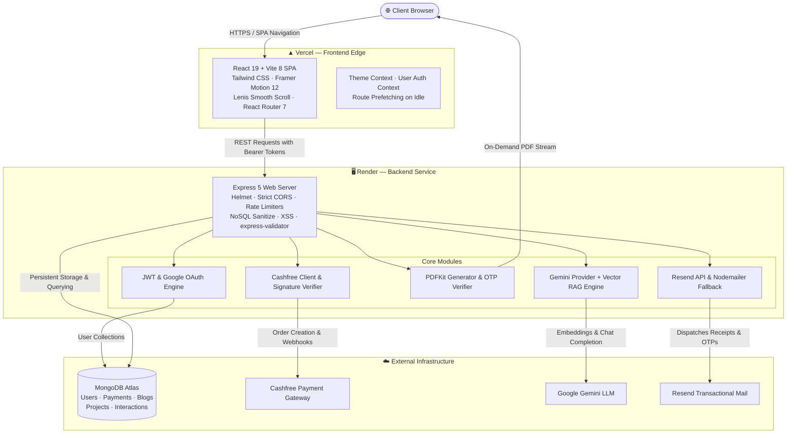

<div align="center">


### Engineering elegant interfaces, resilient backend architectures, and production-grade digital services

[](https://react.dev)
[](https://tailwindcss.com)
[](https://framer.com/motion)
[](https://github.com/darkroomengineering/lenis)
[](https://expressjs.com)
[](https://www.mongodb.com/atlas)
[](https://ai.google.dev)
[](https://www.cashfree.com)
[](https://resend.com)
[](LICENSE)

</div>

---

## 🌟 Executive Summary

This repository houses a **production-ready full-stack software engineer portfolio and services platform** built from the ground up for high performance, enterprise security, and interactive client engagement.

Far beyond a static showcase, it is an interconnected ecosystem featuring:

- 🎨 **31 Dynamic Pages & Interactive Labs** powered by React 19, Vite 8, and Tailwind CSS.
- 🤖 **Nikhil AI Assistant** — a conversational AI widget powered by Google Gemini and a custom vector-chunked RAG (Retrieval-Augmented Generation) portfolio knowledge base.
- 🏗️ **Interactive System Design Blueprints** — real-world architecture teardowns (e.g., URL Shortener / TinyURL) with interactive capacity calculators, component schematics, and trade-off analyses.
- 🧪 **Interactive DSA Lab** — live algorithm visualizers for Sorting (Quick, Merge, Heap, Bubble), Trees, Graphs, and Dynamic Programming.
- 💻 **Cyber Terminal & Security Lab** — interactive Unix-style terminal CLI with custom executables and cybersecurity tool demonstrations.
- 💳 **Production Payment Gateway** — complete Cashfree checkout workflow for booking consulting and freelance development services.
- 🧾 **Fintech Receipt Verification Portal** — self-service portal equipped with one-time password (OTP) email verification, cryptographic download tokens, PDF streaming, and direct email delivery.
- 👤 **User Community & Profile Module** — email authentication and Google OAuth 2.0, interactive profile customization with canvas avatar cropping, and user activity feeds (likes and comments).
- 💬 **Article Interaction Engine** — live community feedback with likes, view counters, and threaded comments on technical articles.
- 🔐 **Secure Admin CMS Dashboard** — protected by JWT and bcrypt, providing real-time analytics, payment tracking, contact management, and blog publishing.
- ⚡ **Ultra-Smooth 120 FPS Motion & Scroll** — Framer Motion `LazyMotion` GPU compositor variants paired with Lenis smooth scrolling that auto-pauses RAF at idle.

---

## 🚀 Live Deployments

| Component | Platform | URL |
|---|---|---|
| **Production Frontend** | Vercel | [https://nikhilxagr.vercel.app](https://nikhilxagr.vercel.app) |
| **Production Backend API** | Render | `https://dev-portfolio-r1ur.onrender.com/api` |
| **API Health Endpoint** | Render | `https://dev-portfolio-r1ur.onrender.com/api/health` |

---

## 🛠️ Complete Tech Stack

### Frontend Architecture

| Technology | Version | Purpose |
|---|---|---|
| **React** | `^19.2.4` | Modern UI library utilizing React 19 hooks and concurrent features |
| **Vite** | `^8.0.1` | Next-generation build engine with Rolldown and instant HMR |
| **Tailwind CSS** | `^3.4.17` | Utility-first styling with custom cyber-neon tokens and glassmorphism |
| **Framer Motion** | `^12.38.0` | Declarative UI animations, `LazyMotion`, spring physics, and `layoutId` |
| **Lenis** | `^1.3.25` | 60/120fps smooth momentum scrolling with smart RAF throttling |
| **React Router DOM** | `^7.13.2` | Client-side routing, route-level code splitting, and prefetching |
| **Lucide React** & **React Icons** | Latest | Lightweight vector iconography suite |
| **React Markdown** & **Prism** | Latest | Markdown rendering with syntax highlighting and sanitization |
| **Sharp** | `^0.34.5` | Asset generation scripts for WebP/AVIF images and multi-size favicons |
| **@vercel/analytics** | `^2.0.1` | Cookie-free, privacy-preserving performance telemetry |

### Backend Architecture

| Technology | Version | Purpose |
|---|---|---|
| **Express** | `^5.2.1` | High-throughput web framework with native async route handling |
| **Mongoose** | `^9.3.3` | Schema validation and connection pooling for MongoDB Atlas |
| **@google/generative-ai**| `^0.24.1` | Google Gemini API integration for conversational AI assistant |
| **Cashfree SDK / REST** | Production | Secure order generation, signature verification, and webhooks |
| **Resend** & **Nodemailer**| `^6.10.0` / `^10.1.2` | Transactional email dispatch for contact forms, receipts, and OTPs |
| **PDFKit** | `^0.18.0` | Server-side cryptographic PDF receipt generator |
| **jsonwebtoken** | `^9.0.3` | Cryptographically signed HMAC-SHA256 access and portal tokens |
| **bcryptjs** | `^3.0.3` | Password hashing with cost factor 12 |
| **Helmet** | `^8.1.0` | Security headers (CSP, HSTS, X-Frame-Options, Sniffing prevention) |
| **express-rate-limit** | `^8.3.2` | Tiered per-route rate limiting to prevent abuse and brute-force attacks |
| **express-validator** | `^7.3.1` | Request parameter and payload sanitization & schema enforcement |
| **express-mongo-sanitize**| `^2.2.0` | Recursive stripping of `$` and `.` to neutralize NoSQL injections |
| **hpp** & **xss** | Latest | HTTP parameter pollution and cross-site scripting sanitization |
| **compression** & **morgan**| Latest | Gzip response compression and structured HTTP logging |

---

## 📂 Repository Layout

```text
Developer Portfolio/
├── frontend/
│   ├── public/                      # Static assets, PWA manifest, favicons, robots.txt
│   ├── scripts/
│   │   ├── generate-favicons.js     # Sharp favicon generator script
│   │   └── generate-seo-assets.js   # Automated sitemap and robots.txt generator
│   ├── src/
│   │   ├── assets/                  # Local media, icons, and vectors
│   │   ├── components/
│   │   │   ├── admin/               # Overview, Messages, and Payments admin tabs
│   │   │   ├── ai/                  # Nikhil AI Chat Panel, Floating Button, Markdown Renderer
│   │   │   ├── animations/          # FadeInUp, ScaleIn, SlideInLeft, StaggerGrid, Parallax
│   │   │   ├── auth/                # ProtectedRoute, SignInModal, UserProfileModal
│   │   │   ├── home/                # HeroSection, ConsistencyDashboard, AboutSection, etc.
│   │   │   ├── layout/              # Navbar, Footer, BackgroundGrid, LenisProvider, SearchModal
│   │   │   ├── seo/                 # SeoHead with JSON-LD schemas and OpenGraph tags
│   │   │   ├── system-design/       # SystemDesignArticleView with interactive calculators
│   │   │   └── ui/                  # ProjectCard, BlogCard, SkillMatrix, UserAvatar, etc.
│   │   ├── config/                  # MotionConfig presets and spring physics settings
│   │   ├── constants/               # Journey timeline, skills logos, and navigation catalog
│   │   ├── context/                 # ThemeContext, UserAuthContext, AuthContext
│   │   ├── hooks/                   # useTypewriter, useFocusTrap, useScrollLock, useActiveSection
│   │   ├── pages/                   # 31 page components (Home, Projects, Labs, Admin, etc.)
│   │   ├── services/                # Axios API services (auth, blogs, projects, payment, ai)
│   │   ├── utils/                   # Motion variants, route prefetching, scroll utilities
│   │   ├── App.jsx                  # Root router, Lenis provider, and route suspense wrappers
│   │   ├── main.jsx                 # Entry point with Theme and UserAuth providers
│   │   └── index.css                # Tailwind directives and custom cyber glassmorphism
│   ├── index.html                   # HTML shell with font and hero preloads
│   ├── tailwind.config.js           # Design tokens, keyframes, and color palettes
│   └── vite.config.js               # Rolldown chunking and manual vendor chunk splits
│
└── backend/
    ├── scripts/
    │   ├── seed.js                  # Database seeder for sample projects and blogs
    │   └── testEmail.js             # Diagnostic script for mailer transports
    └── src/
        ├── ai/                      # AI Assistant Subsystem
        │   ├── controllers/         # Chat stream and health controllers
        │   ├── knowledge/           # Portfolio knowledge base and chunk loader
        │   ├── prompts/             # System prompts and conversational formatting
        │   ├── providers/           # Google Gemini provider abstraction
        │   ├── rag/                 # Chunker, embedder, vector store, and RAG engine
        │   └── services/            # Chat orchestration and session persistence
        ├── config/                  # MongoDB Atlas connection and strict env validation
        ├── constants/               # Services pricing catalog and static project fallbacks
        ├── controllers/             # Express controllers (auth, payments, blogs, etc.)
        ├── middleware/              # Auth, validation, rate limiting, and security stacks
        ├── models/                  # Mongoose models (User, Blog, Project, Payment, etc.)
        ├── routes/                  # Modular express route definitions
        ├── services/                # Mailer service (Resend/SMTP) and receipt emailer
        ├── utils/                   # Cashfree client, PDFKit generator, token signer
        ├── app.js                   # Express application setup, security, and routing
        └── server.js                # HTTP server initialization and graceful shutdown
```

---

## 🗺️ Complete Pages & Navigation Guide (31 Routes)

### 1. Core Portfolio Experience
| Path | Component | Description |
|---|---|---|
| `/` | `HomePage` | Full hero showcase, consistency dashboard, featured projects, skills matrix, and contact CTA |
| `/about` | `AboutPage` | Professional biography, engineering philosophy, tools, and background |
| `/skills` | `SkillsPage` | Interactive categorized technical skills with proficiency breakdowns |
| `/projects` | `ProjectsPage` | Filterable project showcase across Full Stack, AI, Security, and Systems |
| `/projects/:slug` | `ProjectDetailsPage` | Deep dive into architecture, live demo links, source code, and key features |
| `/journey` | `JourneyPage` | Career timeline, milestones, educational credentials, and certifications |
| `/how-i-build` | `HowIBuildPage` | Detailed engineering methodologies, development workflows, and standards |

### 2. Interactive Labs & Security Demos
| Path | Component | Description |
|---|---|---|
| `/system-design` | `SystemDesignPage` | Interactive system design blueprint library and capacity estimators |
| `/system-design/:id`| `SystemDesignPage` | In-depth architectural case studies (e.g. TinyURL / URL Shortener) |
| `/dsa-lab` | `DsaLabPage` | Live interactive visualizer for Sorting, Graph, Tree, and DP algorithms |
| `/terminal` | `TerminalPage` | Unix-style interactive command-line interface with custom commands |
| `/cyber-tools` | `CyberToolsPage` | Interactive cybersecurity tools, encoders, hashers, and security testers |
| `/security` | `SecurityPage` | Comprehensive security disclosures, platform threat model, and practices |
| `/methodology` | `MethodologyPage` | Software design principles, code quality, and testing standards |
| `/experiments` | `ExperimentsPage` | Hub for cutting-edge engineering prototypes and interactive labs |

### 3. Knowledge & Editorial
| Path | Component | Description |
|---|---|---|
| `/blog` | `BlogPage` | Full-stack development, cloud architecture, and security tutorials |
| `/blog/:slug` | `BlogDetailsPage` | Complete article with Markdown parsing, syntax highlighting, likes, and comments |

### 4. Client Services & Payments
| Path | Component | Description |
|---|---|---|
| `/services` | `ServicesPage` | Freelance development packages, consulting services, and direct booking |
| `/support` | `SupportPage` | Service request submission and custom developer support channel |
| `/payment/success` | `PaymentSuccessPage` | Post-transaction confirmation, transaction details, and receipt download |
| `/receipts` | `ReceiptPortalPage` | Secure self-service portal to verify orders, generate OTPs, and download receipts |

### 5. Community & User Account
| Path | Component | Description |
|---|---|---|
| `/profile` | `ProfilePage` | User account settings, interactive avatar cropping, and like/comment activity feed |
| `/auth/callback` | `AuthCallbackPage` | Google OAuth redirect receiver and JWT session initialization |

### 6. Compliance & Policies
| Path | Component | Description |
|---|---|---|
| `/refund-policy` | `RefundPolicyPage` | Standard payment cancellation and refund guidelines |
| `/privacy-policy` | `PrivacyPolicyPage` | User data handling, cookies, and privacy compliance disclosures |
| `/terms-and-conditions` | `TermsPage` | Master terms of service for consulting and digital products |
| `/cancellation-policy` | `CancellationPolicyPage`| Project cancellation and milestone termination terms |
| `/delivery-policy` | `DeliveryPolicyPage` | Service turnaround times and milestone delivery terms |
| `/contact` | `ContactPage` | Direct inquiry form with transactional email delivery |

### 7. Administration (Protected)
| Path | Component | Description |
|---|---|---|
| `/admin/login` | `AdminLoginPage` | Secure administrative authentication screen |
| `/admin` | `AdminDashboardPage` | Central management console for analytics, payments, messages, and blogs |

---

## 📡 REST API Reference

### 1. Authentication & User Profile
```http
POST   /api/auth/login                  # Admin login, returns admin JWT
GET    /api/auth/verify                 # Verify admin token validity

GET    /api/user-auth/google            # Initiate Google OAuth redirect
GET    /api/user-auth/google/callback   # Handle Google OAuth callback
POST   /api/user-auth/google/credential # One-tap Google credential login
POST   /api/user-auth/register          # Register user with email and password
POST   /api/user-auth/login             # Authenticate user with email and password
GET    /api/user-auth/me                # Fetch current user profile (JWT required)
PUT    /api/user-auth/me                # Update name, bio, and avatar (JWT required)
GET    /api/user-auth/activity          # Retrieve user's likes and comments history
```

### 2. Conversational AI Assistant (Google Gemini + RAG)
```http
POST   /api/ai/chat                     # Send query to Nikhil AI (rate-limited, session-tracked)
GET    /api/ai/health                   # Check AI subsystem and knowledge index status
```

### 3. Projects & Portfolio Management
```http
GET    /api/projects                    # List all public projects (with fallback support)
GET    /api/projects/:slug              # Retrieve single project details by slug
POST   /api/projects                    # [Admin] Create a new project showcase
PUT    /api/projects/:id                # [Admin] Update an existing project
DELETE /api/projects/:id                # [Admin] Remove a project
```

### 4. Technical Blog & Community Discussions
```http
GET    /api/blogs                       # List published articles
GET    /api/blogs/:slug                 # Retrieve full article by slug
POST   /api/blogs                       # [Admin] Publish a new blog post
PUT    /api/blogs/:id                   # [Admin] Edit a blog post
DELETE /api/blogs/:id                   # [Admin] Delete a blog post

GET    /api/articles/:articleId/interactions           # Get likes count and threaded comments
POST   /api/articles/:articleId/like                   # Toggle like status (User auth required)
POST   /api/articles/:articleId/comments               # Post comment on article (User auth required)
DELETE /api/articles/:articleId/comments/:commentId    # Delete user's own comment
```

### 5. Payments, Webhooks & Receipt Verification
```http
GET    /api/payments/config-status                     # Check Cashfree environment and readiness
POST   /api/payments/create-order                      # Initialize order for catalog service
POST   /api/payments/create-support-order              # Initialize order for custom support amount
POST   /api/payments/verify                            # Verify Cashfree payment signature
POST   /api/payments/webhook                           # Cashfree automated webhook endpoint
POST   /api/payments/receipts/request-access           # Request 6-digit OTP to user's email
POST   /api/payments/receipts/verify-access            # Validate OTP and receive portal token
GET    /api/payments/receipts/history                  # List receipts for verified email session
GET    /api/payments/receipts/:receiptNumber/download  # Stream cryptographic PDF receipt
POST   /api/payments/receipts/:receiptNumber/email     # Dispatch PDF receipt directly to email
```

### 6. Newsletter, Contacts & Admin Analytics
```http
POST   /api/newsletter/subscribe                       # Join newsletter with welcome email
POST   /api/contact                                    # Submit inquiry (triggers notifications)

GET    /api/admin/overview                             # [Admin] Dashboard KPIs and engagement stats
GET    /api/admin/payments                             # [Admin] Complete transaction log
GET    /api/admin/system-status                        # [Admin] Server memory, uptime, and DB stats
GET    /api/admin/contacts                             # [Admin] Review incoming contact submissions
PATCH  /api/admin/contacts/:id/read                    # [Admin] Mark contact submission as resolved
```

### 7. Health & Uptime Diagnostics
```http
GET    /api/health                                     # Returns server uptime, memory, and DB state
```

---

## 🏗️ System Architecture



---

## 🔒 Comprehensive Security Stack

| Defense Layer | Technology | Security Enforcement |
|---|---|---|
| **HTTP Security Headers** | `helmet` | Enforces HSTS, Strict CSP, prevents MIME-sniffing, disables frame embedding |
| **Cross-Origin Resource Sharing** | `cors` | Restricts access exclusively to verified frontend origins with optional preview regex |
| **Tiered Rate Limiting** | `express-rate-limit` | Individual limiters for Auth, Contact, Payments, AI Chat, and Public reads |
| **Input Validation** | `express-validator` | Strict whitelist validation and length boundaries on all incoming request bodies |
| **NoSQL Injection Defense** | `express-mongo-sanitize` | Recursively sanitizes request objects by removing `$` and `.` operators |
| **Cross-Site Scripting (XSS)** | `xss` | Strips executable script tags and sanitizes user-submitted HTML |
| **Parameter Pollution** | `hpp` | Prevents HTTP Parameter Pollution attacks |
| **Authentication & Tokens** | `jsonwebtoken` + `bcryptjs` | Passwords hashed with cost factor 12; short-lived cryptographically signed tokens |
| **Financial Security** | Cryptographic Tokens | HMAC-SHA256 signature verification for Cashfree webhooks and OTP receipt tokens |

---

## ⚡ Quick Start & Development Setup

### 1. Clone & Install Dependencies

```bash
git clone https://github.com/nikhilxagr/Devloper-Portfolio.git
cd "Devloper-Portfolio"

# Install frontend dependencies
cd frontend
npm install

# Install backend dependencies
cd ../backend
npm install
```

### 2. Configure Backend Environment

Create `backend/.env`:

```env
# Application Settings
NODE_ENV=development
PORT=5000
FRONTEND_URL=http://localhost:5173
ALLOWED_ORIGINS=http://localhost:5173

# Database Connection
MONGODB_URI=mongodb://127.0.0.1:27017/devportfolio
ALLOW_START_WITHOUT_DB=false
DB_MAX_POOL_SIZE=25
DB_MIN_POOL_SIZE=5

# Admin Credentials
JWT_SECRET=your_super_secret_jwt_key_at_least_32_chars_long
JWT_EXPIRES_IN=1d
ADMIN_EMAIL=admin@example.com
ADMIN_PASSWORD_HASH=$2b$12$EXAMPLE_BCRYPT_HASH_HERE

# Google OAuth 2.0 (Optional for local dev)
GOOGLE_CLIENT_ID=your_google_client_id.apps.googleusercontent.com
GOOGLE_CLIENT_SECRET=your_google_client_secret
GOOGLE_CALLBACK_URL=http://localhost:5000/api/user-auth/google/callback

# Google Gemini AI Assistant
GEMINI_API_KEY=your_gemini_api_key_here

# Cashfree Payment Gateway
CASHFREE_APP_ID=your_cashfree_app_id
CASHFREE_SECRET_KEY=your_cashfree_secret_key
CASHFREE_ENVIRONMENT=sandbox
CASHFREE_WEBHOOK_SECRET=your_cashfree_webhook_secret

# Email Services (Resend or SMTP)
RESEND_API_KEY=re_your_resend_api_key
PAYMENT_FROM_EMAIL=receipts@yourdomain.com
PAYMENT_RECEIPT_TOKEN_SECRET=your_receipt_token_secret_32_chars
PAYMENT_RECEIPT_EMAIL_ENABLED=true

# SMTP Fallback
SMTP_HOST=smtp.gmail.com
SMTP_PORT=465
SMTP_SECURE=true
SMTP_USER=your_email@gmail.com
SMTP_PASS=your_gmail_app_password
EMAIL_FROM="Nikhil Agrahari" <your_email@gmail.com>
```

### 3. Configure Frontend Environment

Create `frontend/.env`:

```env
VITE_API_BASE_URL=http://localhost:5000/api
VITE_SITE_URL=http://localhost:5173
```

### 4. Seed Sample Database (Optional)

```bash
cd backend
npm run seed
```

### 5. Launch Local Dev Servers

In terminal 1 (Backend):
```bash
cd backend
npm run dev
```

In terminal 2 (Frontend):
```bash
cd frontend
npm run dev
```

Visit `http://localhost:5173` to explore the full portfolio.

---

## 📈 Recent Commit History & Milestones

- **`1f8069f`** — `style(services)`: Aligned hero typography, responsive stat metrics, and Framer Motion spring physics with blog page specifications.
- **`11b3ca6`** — `fix`: Restored **Nikhil AI** conversational assistant widget with Gemini API streaming across all page routes.
- **`777c0f2`** — `security`: Sanitized receipt portal code paths and verified production token boundaries.
- **`aafa5d3`** — `feat(receipts)`: Enhanced receipt verification portal with financial OTP validation, automated PDF generation, and responsive fintech UI.
- **`fbbbf1c`** — `fix`: Optimized navbar profile dropdown positioning, compact dimensions, and smooth hover transitions.
- **`b3f60c0`** — `feat(user-module)`: Shipped complete user profile suite with image upload, canvas cropping, and likes/comments activity feeds.
- **`1865b1b`** — `feat(system-design)`: Implemented interactive URL Shortener (TinyURL) system design case study with dynamic capacity calculators.
- **`be2aad3`** — `feat(articles)`: Added live community likes, nested discussion threads, auth-gated comments, and author bio cards.
- **`b413d55`** — `feat(showcase)`: Featured comprehensive WhatsApp Web Clone as flagship production architecture.

---

## 📄 Legal & License

This project is open-source and licensed under the **[MIT License](LICENSE)**.

```text
Copyright (c) 2026 Nikhil Agrahari. All rights reserved.
```

- [LICENSE](LICENSE) — Open source usage terms
- [SECURITY.md](SECURITY.md) — Security policies and vulnerability reporting procedures
- [NOTICE](NOTICE) — Third-party library attributions

---

## 📬 Connect & Collaborate

<div align="center">

[](https://nikhilxagr.vercel.app)
[](https://www.linkedin.com/in/nikhilxagr)
[](https://github.com/nikhilxagr)
[](mailto:nikhilagrahari530@gmail.com)

**⭐ Star this repository if you find it helpful!**

</div>
